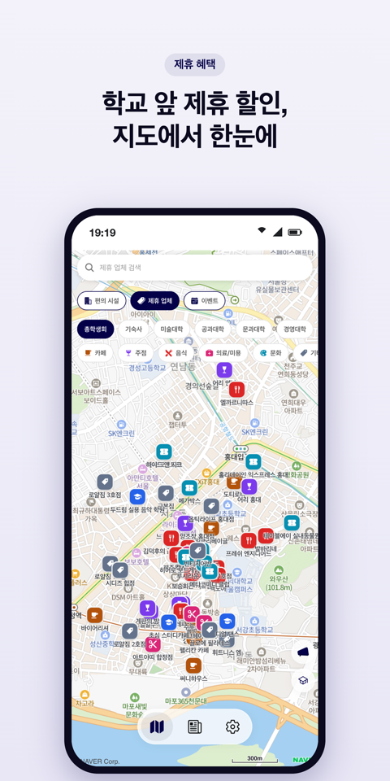
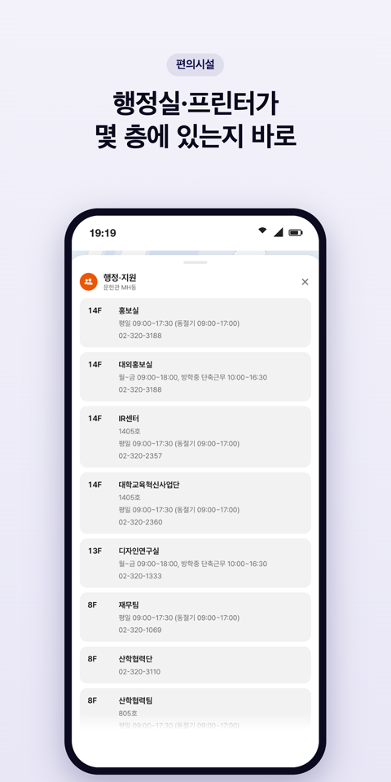
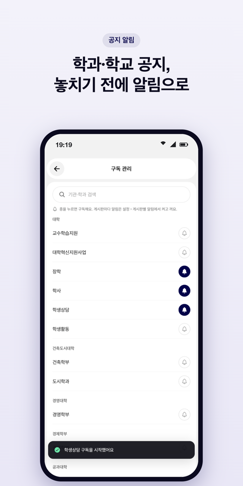
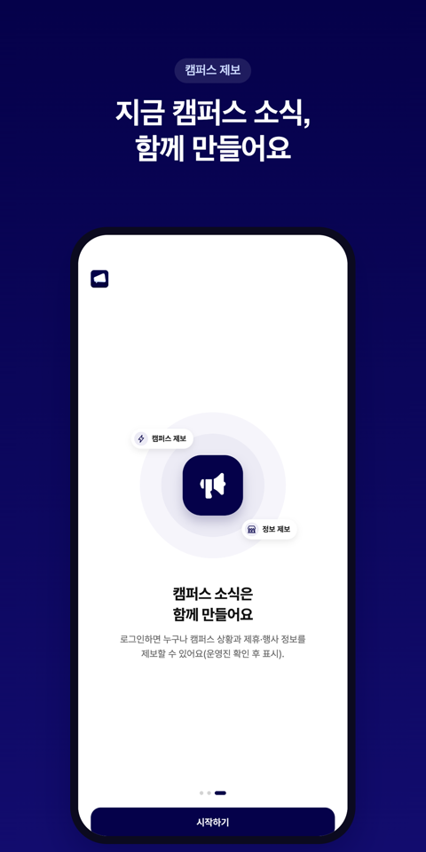

# 홍익온

**홍익대학교 학생을 위한 캠퍼스 앱**

학교 공지 알림, 캠퍼스 지도와 길찾기, 학교 앞 제휴 할인까지 한 앱에서.

 

&nbsp;&nbsp;

<a href="https://hongikon.com">hongikon.com</a> 에서 웹으로도 볼 수 있어요.

 

 

## 공지, 놓치기 전에 알림으로

학교 공지와 학과 게시판의 새 글을 한곳에 모았어요. 보고 싶은 게시판을 구독하거나 키워드를 등록해 두면 새 글이 올라올 때 알림으로 알려 드려요. 모든 공지에는 출처 게시판이 붙어 있고, 학교 홈페이지 원문으로 바로 갈 수 있어요.

## 캠퍼스 지도와 길찾기

행정실, 프린터, 라운지가 몇 층에 있는지 지도에서 바로 찾을 수 있어요. 가려는 건물과 층을 고르면 걷는 길을 안내하고, 계단이나 엘리베이터에서 몇 층으로 가야 하는지도 함께 보여 드려요.

## 학교 앞 제휴 할인

학생회와 단과대학이 공개한 제휴 업체와 혜택을 지도와 목록으로 한눈에 볼 수 있어요.

## 캠퍼스 제보

행사, 푸드트럭처럼 지금 캠퍼스에서 일어나는 일을 지도에 올리고 댓글로 상황을 나눌 수 있어요. 제보는 운영진이 확인한 뒤 지도에 표시돼요.

## 물어보기 BETA

휴학, 수강신청, 장학처럼 학교 일이 궁금하면 물어보세요. 학교 홈페이지 안내와 공지를 근거로 답하고, 답 아래에 원문 링크를 붙여 드려요. 시험 운영 중인 기능이라 중요한 일정과 조건은 원문으로 한 번 더 확인해 주세요.

 

## 로그인 없이 바로

지도, 공지, 제휴 정보는 설치하자마자 로그인 없이 볼 수 있어요. 공지 알림, 제보, 물어보기는 카카오 또는 Apple 로그인 후에 쓸 수 있어요.

## 개인정보

어떤 정보를 왜 받는지는 [개인정보 처리방침](https://hongikon.com/privacy/)에 적어 두었어요. 앱 설정의 회원 탈퇴나 [계정 삭제 안내](https://hongikon.com/account-deletion/)에서 언제든 계정과 데이터를 지울 수 있어요.

## 문의

- 앱 설정 > 문의하기
- 이메일 hongikonsupport@gmail.com
- [고객 지원](https://hongikon.com/support/) · [이용약관](https://hongikon.com/terms/)

 

## 만든 사람들

| 이름 | 맡은 일 | GitHub |
|---|---|---|
| 최석훈 | 앱 | [@Sskskxi](https://github.com/Sskskxi) |
| 주세원 | 서버 | [@sewonzoo](https://github.com/sewonzoo) |
| 이관진 | 기획 · 소식 수집 | [@Jinius36](https://github.com/Jinius36) |

 

---

홍익온은 홍익대학교 학생들이 만든 비공식 서비스로, 홍익대학교와 공식 관계가 없어요. 
Apple 및 Apple 로고는 미국과 기타 국가에서 등록된 Apple Inc.의 상표이며, App Store는 Apple Inc.의 서비스 마크입니다. Google Play 및 Google Play 로고는 Google LLC의 상표입니다.
